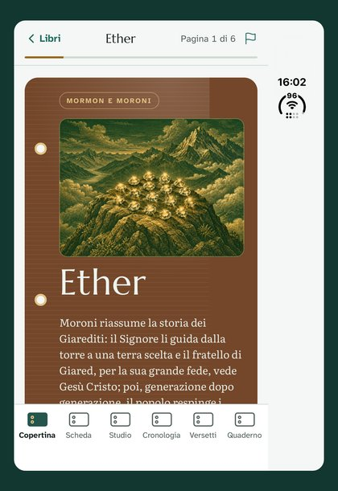
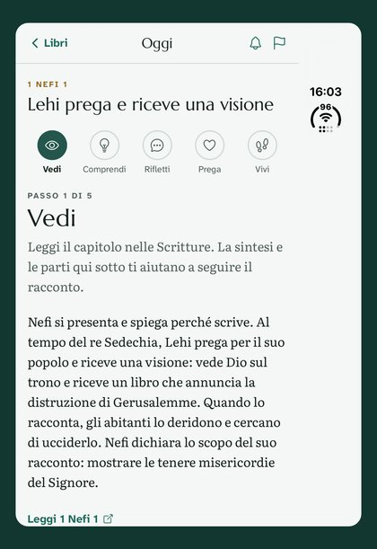
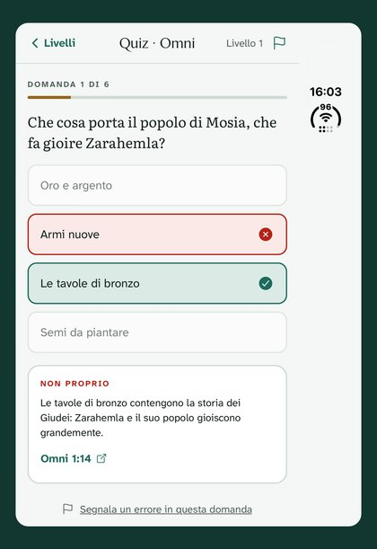
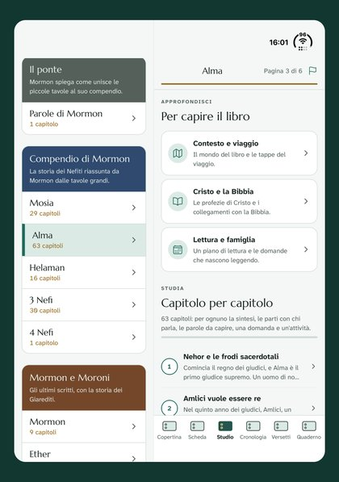

# Hi, I'm Francesco 👋

### I build apps people actually use.

Mobile & web developer · Founder of [FF Horizon Studio](https://github.com/FF-Horizon-Studio) · Italy 
Two apps live on the App Store and Google Play, built end to end: idea, design, code, backend and store release.

---

## 📱 Shipped and live

<table>
<tr>
<td width="100" valign="top"></td>
<td valign="top">

**LehiQuest** · *Learn the Book of Mormon by playing* 
A free, unofficial study companion: all 15 books with chapter guides, a daily study rhythm with reminders, 7 games on 3 levels, search and cross-references. Italian and English, content built in, optional account with real-time sync across devices.

`Expo` `React Native` `TypeScript` `Supabase` `EAS`

</td>
</tr>
<tr>
<td width="100" valign="top"></td>
<td valign="top">

**Il Mio Rione** · *The app of your local congregation* 
A free, unofficial app for wards and branches of The Church of Jesus Christ of Latter-day Saints: announcements, calendar, sacrament meeting, service and mutual help. Built to host many congregations from day one.

`Expo` `React Native` `TypeScript` `Supabase` `Realtime`

</td>
</tr>
</table>

  
  
  
  

---

## 🧪 More projects

| Project | What it does | Stack | |
|---|---|---|---|
| **[VoyageAI](https://github.com/fforesta-dev/voyage-ai)** | AI travel planner: personalized itineraries from budget, dates and preferences. BYU–Idaho senior project. | TypeScript · C# / .NET · Azure | [Live](https://voyage-ai-ashen-pi.vercel.app) |
| **[Language Learning Companion](https://github.com/fforesta-dev/language-learning-companion)** | Vocabulary PWA: word of the day with audio, translation, quizzes, favorites. WCAG 2.1 AA. | JavaScript · PWA · REST APIs | [Live](https://francescoforesta.is-a.dev/language-learning-companion/) |
| **[Snake Arcade](https://github.com/fforesta-dev/game-framework)** | 2D arcade game with a real-time game loop, collisions and growing speed. | Python · Arcade | [Demo](https://youtu.be/aykXpQkhkLk) |
| **[Italian Flashcards](https://github.com/fforesta-dev/mobile-app)** | Android app to learn Italian expressions, with local persistence and dark mode. | Kotlin · Android | [Demo](https://youtu.be/eF-YRE_ieXg) |
| **[Cloud To-Do](https://github.com/fforesta-dev/cloud-databases)** | CLI app with full CRUD on related collections in the cloud. | Python · Firestore | [Demo](https://youtu.be/h_fRlOW_Ld4) |

---

## 🛠️ Toolbox

  

<b>Mobile:</b> Expo · React Native · EAS Build &amp; Submit · App Store Connect · Google Play Console

---

## 🌍 Beyond code

I'm a **Senior Learning & Development Coordinator** for global teams, and I come from years of **translation and localization (EN · IT · FR)**. It shows in what I build: apps that teach, and that ship in more than one language from day one.

**Graduated**
- 🎓 **Software Development** · Brigham Young University–Idaho
- 🎓 **Applied Linguistic Mediation (Interpreting and Translation)** · University of Perugia
- 📜 Three postgraduate master's in translation (audiovisual, literary, specialized)

**Studying now**
- 📚 **Information Technology – System Administration** · BYU-Pathway Worldwide (BYU–Idaho · Ensign College)
- 🔐 **MSc Cyber Security** · University of Liverpool (from November 2026)
- 💻 **Full-Stack AI Developer** · Epicode

---

  

<i>Building at the intersection of technology, learning and languages.</i>

